# Finance-Tracker-Backend

RESTful API for a Personal Finance Tracker built with Node.js, Express.js, MongoDB, Mongoose, and JWT authentication.

## Table of Contents

- [1. Introduction](#1-introduction)
- [2. Research](#2-research)
- [3. Tech Stack and Reasons for Choosing](#3-tech-stack-and-reasons-for-choosing)
- [4. Introduction to Libraries](#4-introduction-to-libraries)
- [5. Project Functionality with Screenshots](#5-project-functionality-with-screenshots)
- [6. Conclusion](#6-conclusion)
- [Live Demo](#live-demo)
- [Installation and Setup](#installation-and-setup)
- [Environment Variables](#environment-variables)
- [API Endpoints](#api-endpoints)

---

## 1. Introduction

Thrive is a Personal Finance Tracker designed to help users manage their income, expenses, and monthly budgets efficiently.

The backend of Thrive provides a secure and structured RESTful API that handles user authentication, transaction management, and budget tracking. It connects the frontend application with the MongoDB database and ensures that each user can access and manage only their own financial records.

The backend follows a modular architecture, making the application easier to maintain, understand, and extend.

### Objectives

- Develop a RESTful API for personal financial management.
- Implement secure user registration and login.
- Protect routes using JSON Web Token (JWT) authentication.
- Store and manage financial transactions.
- Enable users to create and manage monthly budgets.
- Calculate budget spending, remaining amounts, and utilization percentages.
- Ensure user-specific access to financial data.
- Integrate the backend with the Thrive frontend application.

---

## 2. Research

### Problem Statement

Managing personal finances manually can be difficult, especially when users need to track multiple income sources, expenses, and monthly spending limits.

Without a centralized system, users may struggle to understand their spending habits, maintain financial records, and stay within their budgets.

### Research and Analysis

Before developing the backend, the requirements of a personal finance management system were analyzed.

The following key requirements were identified:

- **User Authentication:** Users should be able to register and log in securely.
- **Transaction Management:** Users should be able to record, view, update, and delete income and expenses.
- **Budget Management:** Users should be able to define monthly spending limits for different categories.
- **Data Security:** Financial records should be accessible only to their respective owners.
- **Spending Analysis:** The system should calculate the total amount spent against a budget and determine the remaining amount.
- **API Integration:** The backend should communicate efficiently with the frontend through RESTful API endpoints.

### Proposed Solution

Thrive addresses these requirements through a backend built with Node.js, Express.js, and MongoDB.

JWT-based authentication is used to protect private routes, while Mongoose models define the structure of user, transaction, and budget data.

The backend provides the essential functionality required for a personal finance tracker and supports the frontend dashboard, transaction management, budgeting, and reports.

---

## 3. Tech Stack and Reasons for Choosing

| Technology | Purpose | Reason for Choosing |
|---|---|---|
| Node.js | Backend runtime environment | Allows JavaScript to be used on the server side and supports asynchronous operations efficiently. |
| Express.js | Backend web framework | Provides a lightweight and flexible framework for creating REST APIs and managing routes and middleware. |
| MongoDB | NoSQL database | Stores financial records in a flexible document-based structure. |
| Mongoose | MongoDB object modeling | Provides schemas, validation, and structured interaction with MongoDB. |
| JavaScript | Programming language | Enables consistent use of JavaScript across the frontend and backend. |
| JWT | Authentication | Provides token-based authentication for protecting private API routes. |
| Render | Backend deployment platform | Enables deployment of the backend API for production use. |

---

## 4. Introduction to Libraries

The following libraries and packages were used during backend development.

| Library / Package | Purpose |
|---|---|
| `express` | Used to create the server, define API routes, and handle HTTP requests and responses. |
| `mongoose` | Used to connect to MongoDB and define database models and schemas. |
| `jsonwebtoken` | Used to generate and verify JWT authentication tokens. |
| `bcryptjs` | Used to securely hash user passwords before storing them in the database. |
| `cors` | Enables controlled cross-origin requests between the frontend and backend. |
| `dotenv` | Loads environment variables from the `.env` file. |
| `nodemon` | Automatically restarts the backend server during development when files are modified. |

### Security Implementation

The backend incorporates the following security practices:

- Passwords are hashed using `bcryptjs` before being stored.
- JWT tokens are used to authenticate users.
- Protected routes require a valid authentication token.
- User-specific transactions and budgets are accessed through authenticated user ownership.
- Input validation is performed for required fields and financial values.
- Sensitive configuration values are stored in environment variables rather than hardcoded into the source code.

---

## 5. Project Functionality with Screenshots

Thrive Backend provides APIs for user authentication, transaction management, and budget management.

### 5.1 Backend Server and Database Connection

The backend server is built using Express.js and connected to MongoDB through Mongoose.

The root endpoint confirms that the backend server is running successfully.

**Screenshot: Backend Health Check**

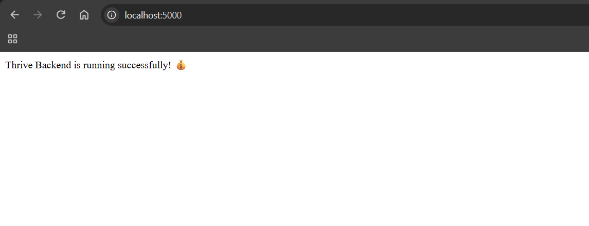

### 5.2 User Authentication

The authentication module allows users to register and log in.

#### User Registration

- Accepts user name, email, and password.
- Validates the registration details.
- Checks whether the email address is already registered.
- Hashes the password before saving the user.

**Screenshot: Register API Success**

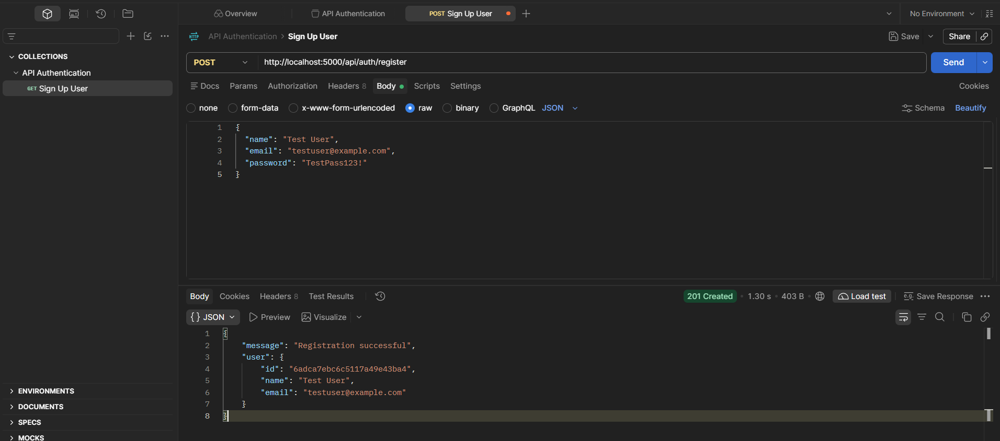

#### User Login

- Validates the user's login credentials.
- Compares the submitted password with the stored password hash.
- Generates a JWT token after successful authentication.
- Provides the token for accessing protected routes.

**Screenshot: Login API Success**

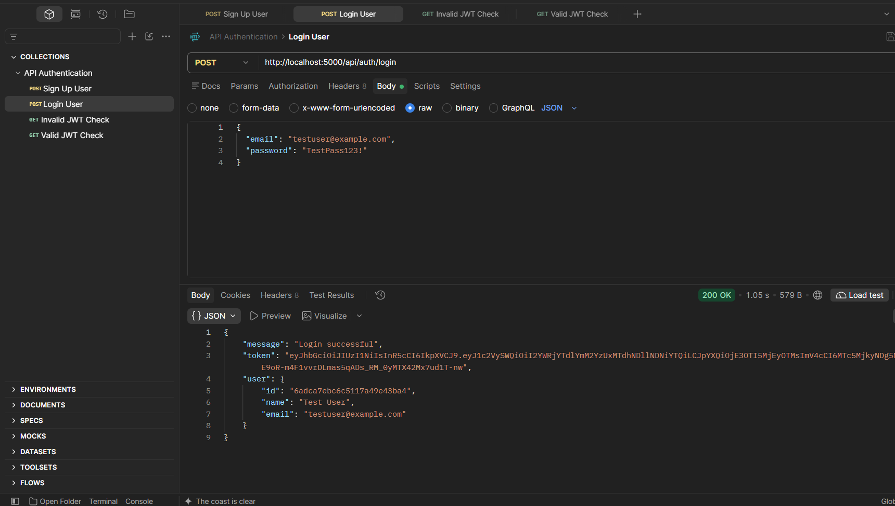

#### Protected Route

The protected route verifies the JWT token before allowing access to authenticated resources.

**Screenshot: Unauthorized Protected Route**

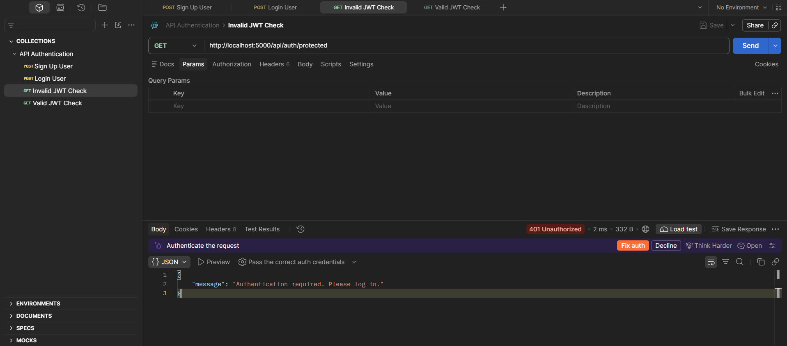

### 5.3 Transaction Management

The transaction module allows authenticated users to manage their financial records.

Each transaction contains the following fields:

- Transaction type: Income or Expense
- Name
- Amount
- Category
- Description
- Date

The following operations are supported:

- Add a new transaction.
- Retrieve the user's transactions.
- Update an existing transaction.
- Delete a transaction.

**Screenshot: Add Transaction API**

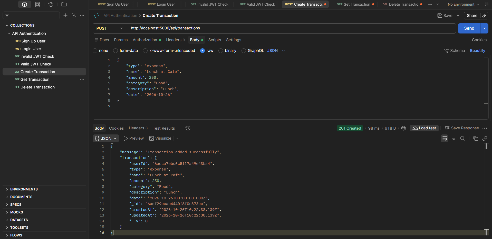

**Screenshot: Get Transactions API**

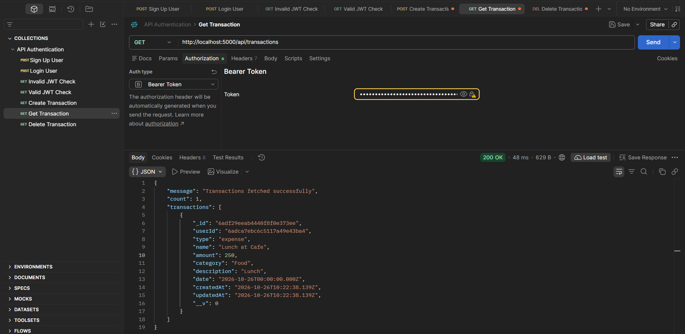

**Screenshot: Delete Transaction API**

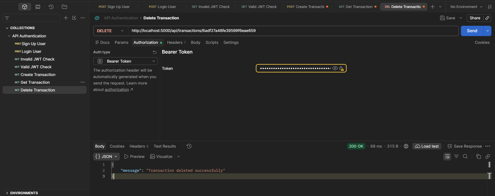

### 5.4 Budget Management

The budget module allows authenticated users to create and manage monthly category-wise budgets.

Each budget contains:

- Category
- Budget amount
- Month
- Year

The module supports:

- Creating a monthly budget.
- Retrieving budgets for a selected month and year.
- Updating an existing budget.
- Deleting a budget.
- Calculating the amount spent in a category.
- Calculating the remaining budget.
- Calculating the budget utilization percentage.
- Identifying when a budget limit has been exceeded.

A unique budget is maintained for each category, user, month, and year.

**Screenshot: Create Budget API**

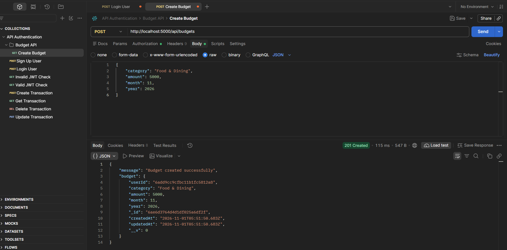

**Screenshot: Fetch Budget Spending API**

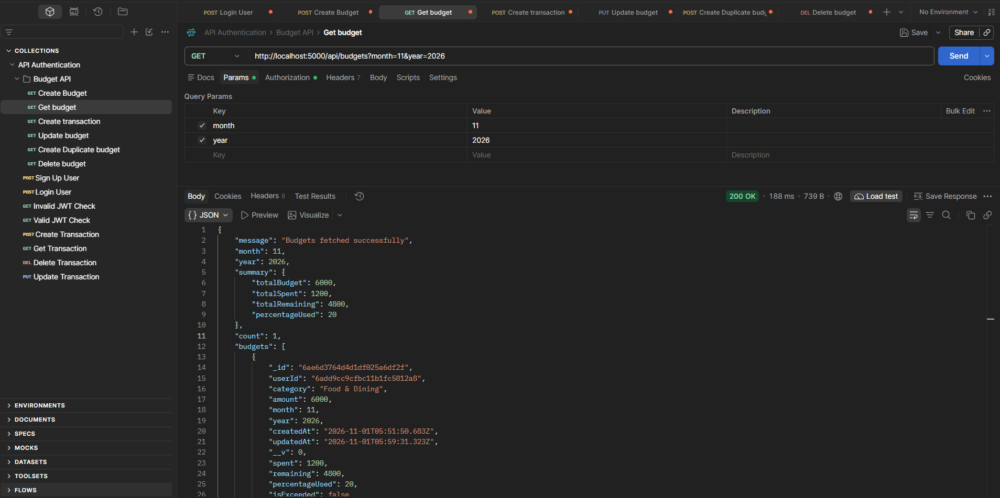

**Screenshot: Update Budget API**

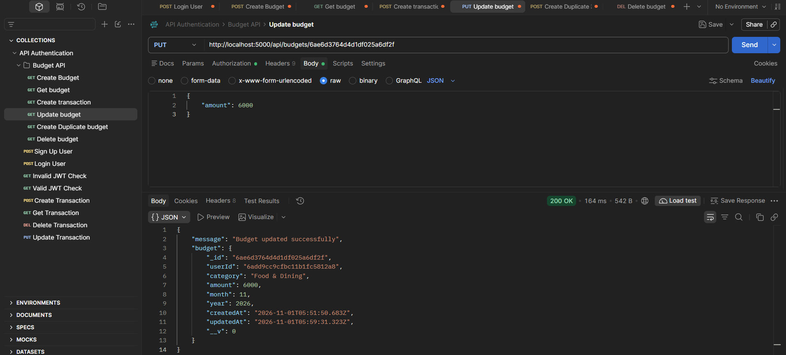

**Screenshot: Validation and Security**

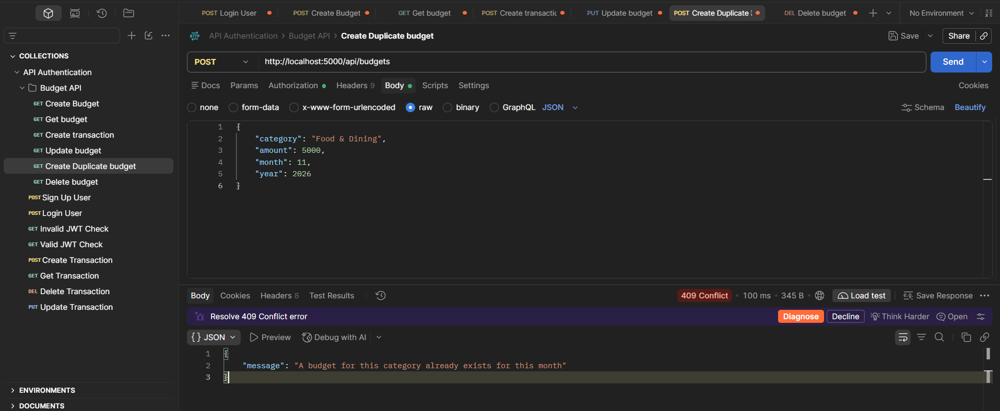

### 5.5 API Testing

The backend APIs were tested using Postman.

Testing covered:

- User registration and login.
- Successful and unsuccessful authentication.
- Protected route access.
- Creating, retrieving, updating, and deleting transactions.
- Creating, retrieving, updating, and deleting budgets.
- Validation of required fields and financial values.
- Authentication and user-specific data access.

---

## 6. Conclusion

The Thrive Backend successfully implements the core functionality required for a personal finance management application.

Through the use of Node.js, Express.js, MongoDB, and Mongoose, the backend provides a structured and maintainable RESTful API. JWT authentication and password hashing help secure user accounts, while transaction and budget management APIs enable users to organize their financial records.

The project provided practical experience in backend development, REST API design, database modeling, authentication, middleware implementation, API testing, and deployment.

The backend is integrated with the Thrive frontend and deployed on Render, making the application accessible in a production environment.

Thrive can be further enhanced by adding features such as recurring transactions, financial goal tracking, advanced analytics, and automated notifications.

---

## Live Demo

- **Frontend Application:** [Thrive Finance Tracker](https://thrive-finance-tracker.vercel.app/)
- **Backend API:** [Thrive Backend](https://thrive-backend-zcug.onrender.com/)
- **GitHub Repository:** [Finance-Tracker-Backend](https://github.com/ishitaverma-cse/Finance-Tracker-Backend)

---

## Installation and Setup

Follow these steps to run the backend locally.

### Prerequisites

Ensure that the following are installed:

- Node.js
- npm
- MongoDB Atlas account or a local MongoDB instance
- Git
- Postman (for API testing)

### Step 1: Clone the Repository

```bash
git clone https://github.com/ishitaverma-cse/Finance-Tracker-Backend.git
```

### Step 2: Navigate to the Project Directory

```bash
cd Finance-Tracker-Backend
```

### Step 3: Install Dependencies

```bash
npm install
```

### Step 4: Configure Environment Variables

Create a `.env` file in the root directory and add the required environment variables.

Refer to the Environment Variables section below.

### Step 5: Start the Backend Server

For development:

```bash
npm run dev
```

For production:

```bash
npm start
```

The backend server will run at:

```text
http://localhost:5000
```

The API base URL will be:

```text
http://localhost:5000/api
```

---

## Environment Variables

Create a `.env` file in the root directory.

```env
PORT=5000
MONGO_URI=your_mongodb_connection_string
JWT_SECRET=your_jwt_secret
FRONTEND_URL=http://localhost:5173
```

| Variable | Description |
|---|---|
| `PORT` | Port on which the backend server runs. |
| `MONGO_URI` | MongoDB connection string. |
| `JWT_SECRET` | Secret key used for signing and verifying JWT tokens. |
| `FRONTEND_URL` | Frontend origin allowed to access the backend through CORS. |

**Important:** Never commit your `.env` file or expose your database connection string or JWT secret in a public repository.

For production deployment, configure the environment variables through the Render dashboard.

---

## API Endpoints

The following endpoints are provided by the Thrive Backend.

### Authentication APIs

| Method | Endpoint | Description | Authentication |
|---|---|---|---|
| POST | `/api/auth/register` | Register a new user | No |
| POST | `/api/auth/login` | Log in and generate a JWT token | No |
| GET | `/api/auth/protected` | Access a protected route | Yes |

### Transaction APIs

| Method | Endpoint | Description | Authentication |
|---|---|---|---|
| POST | `/api/transactions` | Add a new transaction | Yes |
| GET | `/api/transactions` | Retrieve user transactions | Yes |
| PUT | `/api/transactions/:id` | Update a transaction | Yes |
| DELETE | `/api/transactions/:id` | Delete a transaction | Yes |

### Budget APIs

| Method | Endpoint | Description | Authentication |
|---|---|---|---|
| POST | `/api/budgets` | Create a new budget | Yes |
| GET | `/api/budgets?month=<month>&year=<year>` | Retrieve budgets for a selected month and year | Yes |
| PUT | `/api/budgets/:id` | Update a budget | Yes |
| DELETE | `/api/budgets/:id` | Delete a budget | Yes |

Protected endpoints require a valid JWT token to be sent in the request header:

```http
Authorization: Bearer <your_jwt_token>
```

---

## Project Structure

```text
Finance-Tracker-Backend/
│
├── config/
│   └── db.js
│
├── middleware/
│   └── authMiddleware.js
│
├── models/
│   ├── User.js
│   ├── Transaction.js
│   └── Budget.js
│
├── routes/
│   ├── authRoutes.js
│   ├── transactionRoutes.js
│   └── budgetRoutes.js
│
├── docs/
│   ├── day-1/
│   ├── day-4/
│   ├── day-5/
│   └── day-10/
│
├── server.js
├── package.json
├── package-lock.json
└── .gitignore
```

---

**Developed as part of the Thrive Personal Finance Tracker project.**
